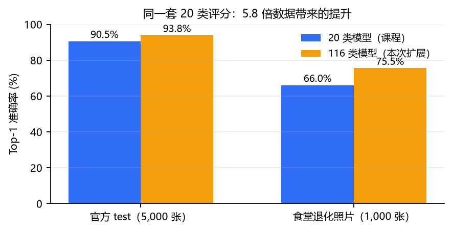

# 校园食堂菜品识别与热量区间估算

课程项目作业 02 的完整实现：拍照识别 20 类菜品，输出 **Top-3 菜品 + 粗略热量区间**，并配有可交互的网页界面。

- 数据集：**Food-101**（Bossard et al., ECCV 2014）官方划分的子集，20 类，训练 12,000 / 验证 2,000 / 测试 5,000 张。
- 模型：ResNet-18、MobileNetV3-Small（ImageNet 预训练 + 分类头重训 + 最后一阶段解冻微调）。
- 对比实验：冻结 vs 解冻、公开测试集 vs 食堂代理域、颜色增强前后、ImageNet 预训练 vs 随机初始化。
- 额外分析：置信度校准（温度缩放）、份量切换与手动输入重量对热量区间的影响。
- 混合餐盘：多标签模型判断盘子里同时有哪几样菜（如薯条 + 鸡翅），每部分单独选份量或填克数，输出各部分与整盘热量区间。
- 指标：Accuracy、Macro-F1、混淆矩阵、跨域性能、ECE、Params、MACs、GPU/CPU 推理耗时。

## 1. 目录结构

```
food_project/
├─ data/                     # 数据（不入库，见第 3 节）
│  ├─ raw_hf/               # HuggingFace food101 parquet 原始分片
│  ├─ raw/food-101/         # 抽取后的 images/ 与 images_test/（20 类）
│  ├─ wide/                 # 116 类（Food-101 101 类 + 15 道中餐）：raw/ 与 splits/{train,val,test}
│  ├─ external/             # brand_menu.json（麦当劳中国官网营养表，见 5.6）
│  └─ splits/               # train / val / test / canteen / canteen_clean / mixed
├─ src/foodcls/
│  ├─ classes.py            # 20 类定义：英文名、中文名、每 100 g 热量、常见份量
│  ├─ classes_wide.py       # 116 类定义（前 101 个为 Food-101，按字母序对齐旧权重）
│  ├─ calorie.py            # 热量区间估算（低置信度放宽、份量缩放、手动重量）
│  ├─ brands.py             # 连锁品牌营养参考（官网菜单 → 类别对照与可搜索面板）
│  ├─ mixed.py              # 混合餐盘：合成多标签样本、阈值检测、各部分热量合计
│  ├─ data.py               # 数据集、变换、食堂拍摄退化流水线
│  ├─ models.py             # 三种网络 + 三种微调策略
│  ├─ train.py              # 训练/评估入口（AMP、AdamW、余弦退火、按 val Macro-F1 存最优）
│  ├─ utils.py              # 指标、ECE、Params、THOP MACs、延迟测量
│  ├─ app.py                # FastAPI 网页服务（含 /api/qr.png、manifest、sw.js）
│  ├─ predict.py            # 命令行单图预测
│  └─ static/               # 前端单页 index.html、PWA manifest、Service Worker、应用图标
├─ miniprogram/             # 微信小程序版（导入微信开发者工具，改 config.js 的 BASE_URL）
├─ docs/                    # 使用文档：永久公网地址.md、微信小程序上手指南.md
├─ scripts/
│  ├─ fetch_food101_hf.py   # 从 hf-mirror 下载 parquet 分片
│  ├─ extract_food101_hf.py # 抽取 20 类（或 --all 抽全 101 类）到本地目录结构
│  ├─ prepare_data.py       # 生成 train/val/test/canteen 划分
│  ├─ prepare_wide_data.py  # Food-101 101 类的 train/val/test 划分（650/100/250 每类）
│  ├─ fetch_kaggle.py       # 匿名下载 Kaggle 数据集（多线程分段 Range）
│  ├─ add_chinese_dishes.py # 解压 16 道中餐，按自带划分并入 data/wide/splits
│  ├─ fetch_brand_nutrition.py # 抓麦当劳中国官网营养表 → data/external/brand_menu.json
│  ├─ run_all.py            # 一键跑 6 组实验 + benchmark + 画图
│  ├─ train_mixed.py        # 训练多标签混合餐盘模型（合成 2–3 菜拼盘）
│  ├─ train_wide.py         # 训练 116 类模型（--init 热启动扩类，三视角 TTA + 温度缩放）
│  ├─ make_mixed_samples.py # 生成网页用的混合餐盘示例图与真值 labels.json
│  ├─ benchmark.py          # Params / MACs / GPU-CPU 延迟
│  ├─ make_figures.py       # 论文与报告用图
│  ├─ make_paper_numbers.py # 从结果文件生成 LaTeX 数字宏
│  ├─ make_readme.py        # 由结果生成下方表格
│  ├─ fit_temperature.py    # 温度缩放校准（val 上拟合，输出 calibration.json）
│  ├─ eval_real_photos.py   # 用真实食堂照片评估（两种目录布局）
│  ├─ eval_mixed.py         # 混合餐盘阈值细扫（写 mixed_threshold.json / 画阈值曲线）
│  ├─ eval_openset.py       # 开集门控：三视角一致性，误报/检出率与分布图
│  ├─ eval_wide_domain.py   # 116 类模型在 20 类食堂数据上的对比评估
│  ├─ eval_wide_gate.py     # 116 类模式的门控阈值（官方 test 最差分数的 5% 分位）
│  ├─ eval_wide_groups.py   # 116 类 test 评测：单视角 / TTA / ECE / 分组 / 每类
│  ├─ eval_tta.py           # 测试时增强（翻转/五裁剪/多尺度）与代理域重抽（种子 7）
│  ├─ finalize_wide.py      # 单次遍历 test 重算单视角/TTA/ECE，写回 results.json
│  ├─ make_wide_figure.py   # 画 20 类 vs 116 类在同一评分下的对比图
│  ├─ start_demo.ps1        # 一键启动网页（监听 0.0.0.0，打印局域网地址，-Qr 出扫码图）
│  ├─ start_public.ps1      # 公网临时链接（Cloudflare 快速隧道，任何网络都能打开）
│  ├─ setup_cloudflare_tunnel.ps1 # 固定地址：创建 Cloudflare 命名隧道并绑定自己的域名
│  ├─ start_permanent.ps1    # 固定地址：启动后端 + 命名隧道（配合上一个脚本）
│  ├─ start_funnel.ps1       # 固定地址：Tailscale Funnel（不买域名）
│  ├─ start_ngrok.ps1        # 固定地址：ngrok 免费固定域名（有配额）
│  ├─ package_demo.ps1      # 打包成可发给他人独立运行的 zip
│  ├─ demo_screenshot.ps1   # 启动服务并截图网页
│  └─ make_icons.py         # 生成 PWA 图标（192 / 512 / maskable）
├─ tests/                   # unittest：热量区间规则、类别表/变换/模型工厂契约
├─ results/
│  ├─ runs/<实验名>/        # best.pt, last.pt, history.csv, results.json, pred_*.npz
│  │                        # （含 20 类的 E1–E6、resnet18_multilabel_*、resnet18_food101、
│  │                        #  resnet18_food101_cn116）
│  ├─ figures/              # 混淆矩阵、曲线、Grad-CAM、开集分布、缩放对比、网页截图
│  └─ tables/               # complexity.json、summary.csv、mixed*.json、openset_gate.json、wide_*.json
└─ paper/                   # IEEE 会议格式英文论文（LaTeX）
```

## 2. 环境

- Windows + Python 3.13，NVIDIA RTX 4060 Laptop (8 GB)，PyTorch 2.11.0 + CUDA 12.8。
- 安装：

```powershell
python -m venv .venv
.\.venv\Scripts\python.exe -m pip install torch torchvision --index-url https://download.pytorch.org/whl/cu128
.\.venv\Scripts\python.exe -m pip install -r requirements.txt
```

预训练权重默认缓存到 `food_project/.torch`（由 `src/foodcls/__init__.py` 设置 `TORCH_HOME`），无需写入用户目录。

单元测试用标准库 `unittest`，不需要 pytest，也不需要数据集（21 个用例，约 1 秒）：

```powershell
cd "E:\项目作业\food_project"
.\.venv\Scripts\python.exe -m unittest discover -s tests -v
```

覆盖：热量区间的边界（克数覆盖份量先验、低置信度加宽、取整）、类别表一致性、训练/评测变换的形状、模型工厂与微调冻结策略。

## 3. 数据准备

```powershell
# 1) 下载 Food-101 的 parquet 分片（约 4.7 GB，来自 hf-mirror 镜像）
python scripts/fetch_food101_hf.py --workers 4
# 2) 抽取本实验使用的 20 类
python scripts/extract_food101_hf.py
# 3) 划分：官方 train 750/类 -> train 600 + val 100 + probe 50；官方 test 250/类 -> test
python scripts/prepare_data.py
```

划分原则：

- 训练、验证、测试三部分**互不重叠**，且测试集严格来自 Food-101 官方 test 划分。
- `canteen_clean`（每类 50 张，共 1,000 张）不参与训练和选模，只用于生成 `canteen` 代理域。
- `canteen` 是对 `canteen_clean` 做手机拍摄退化（旋转、透视、裁剪、暖光/荧光白平衡、亮度对比度、高斯/运动模糊、暗角、噪声、JPEG 35–65）得到的**代理域**，用于模拟"食堂实拍"。真实手机照片可直接上传到网页界面，或放进 `data/splits/canteen/<类名>/` 后重跑评估脚本，无需改代码。

## 4. 训练与评估

```powershell
cd src
# 单组实验（示例：解冻最后阶段 + 颜色增强，12 epochs）
..\.venv\Scripts\python.exe -m foodcls.train --data-root ../data --out ../results/runs/resnet18_last_stage_aug --tag resnet18_last_stage_aug --arch resnet18 --mode last_stage --epochs 12 --color-aug
```

`--mode` 可选 `frozen` / `last_stage` / `full`；`--arch` 可选 `resnet18` / `mobilenet_v3_small` / `efficientnet_b0`。
加 `--no-pretrained` 可从头训练（随机初始化），用于消融"ImageNet 预训练到底贡献多少"：

```powershell
..\.venv\Scripts\python.exe -m foodcls.train --data-root ../data --out ../results/runs/resnet18_scratch_noaug --tag resnet18_scratch_noaug --arch resnet18 --mode full --no-pretrained --epochs 12
```

一键复现全部 6 组实验、复杂度基准与所有图表：

```powershell
.\\.venv\\Scripts\\python.exe scripts/run_all.py
```

训练使用 AdamW（头 1e-3 / 主干 1e-4）、余弦退火、label smoothing 0.1、AMP，按验证集 Macro-F1 选择最优权重，训练结束后一次性评测 val / test / canteen 三个集合。

混合餐盘模型（多标签，二值交叉熵）单独训练，盘面由 Food-101 训练图现场合成：

```powershell
.\\.venv\\Scripts\\python.exe scripts/train_mixed.py --epochs 12 --n-train 16000
.\\.venv\\Scripts\\python.exe scripts/make_mixed_samples.py
```

每个训练盘以 35% / 45% / 20% 的概率放 1 / 2 / 3 样菜（斜切或三扇区掩膜羽化混合），目标为 20 维多热向量；阈值在验证盘上扫描取 F1 最优，同时报告同一权重在单菜测试集上的 Top-1，确保多标签能力没有把单菜识别带崩。

116 类扩展模型（Food-101 101 类 + 15 道中餐；从 101 类权重热启动，全量微调）：

```powershell
.\.venv\Scripts\python.exe scripts/fetch_kaggle.py --dataset patzer0/16-famous-chinese-dishes --out data/external/16chinese.zip
.\.venv\Scripts\python.exe scripts/add_chinese_dishes.py
.\.venv\Scripts\python.exe scripts/prepare_wide_data.py
.\.venv\Scripts\python.exe scripts/train_wide.py --epochs 10 --batch-size 96 --workers 6 --out results/runs/resnet18_food101
.\.venv\Scripts\python.exe scripts/train_wide.py --epochs 4 --batch-size 96 --workers 6 --init results/runs/resnet18_food101/best.pt --lr-head 5e-4 --lr-backbone 5e-5 --out results/runs/resnet18_food101_cn116
.\.venv\Scripts\python.exe scripts/eval_wide_groups.py --run results/runs/resnet18_food101_cn116
.\.venv\Scripts\python.exe scripts/eval_wide_domain.py
```

## 5. 实验结果

| ID | 模型 / 策略 | 颜色增强 | Test Acc | Test Macro-F1 | Proxy Acc | Cross-domain Gap | Params (M) | MACs (G) | 训练时长 (min) |
| --- | --- | --- | --- | --- | --- | --- | --- | --- | --- |
| E1 | ResNet-18 · 冻结 | 否 | 84.44% | 84.43% | 64.00% | 20.4 pt | 11.19 | 1.82 | 4.0 |
| E2 | ResNet-18 · 冻结 | 是 | 84.08% | 84.04% | 64.30% | 19.8 pt | 11.19 | 1.82 | 5.6 |
| E3 | ResNet-18 · 解冻最后阶段 | 否 | 89.74% | 89.76% | 64.00% | 25.7 pt | 11.19 | 1.82 | 3.8 |
| E4 | ResNet-18 · 解冻最后阶段 | 是 | 90.54% | 90.55% | 66.00% | 24.5 pt | 11.19 | 1.82 | 5.9 |
| E5 | MobileNetV3-Small · 解冻最后阶段 | 是 | 81.92% | 81.94% | 57.20% | 24.7 pt | 1.54 | 0.06 | 4.9 |
| E6 | ResNet-18 · 随机初始化（全网络） | 否 | 66.04% | 65.71% | 35.60% | 30.4 pt | 11.19 | 1.82 | 7.4 |

推理耗时（FP32，batch=1，预热 10 次后取 50 次均值）：

| ID | 模型 | GPU 单张 (ms) | CPU 单张 (ms) | GPU FPS |
| --- | --- | --- | --- | --- |
| E1 | ResNet-18 · 冻结 | 3.39 | 16.78 | 295 |
| E2 | ResNet-18 · 冻结 | 3.20 | 15.52 | 312 |
| E3 | ResNet-18 · 解冻最后阶段 | 3.79 | 17.10 | 264 |
| E4 | ResNet-18 · 解冻最后阶段 | 3.70 | 17.04 | 270 |
| E5 | MobileNetV3-Small · 解冻最后阶段 | 5.77 | 9.04 | 173 |
| E6 | ResNet-18 · 随机初始化（全网络） | 4.36 | 16.19 | 230 |

图表位于 `results/figures/`：训练曲线、对比柱状图、测试集与代理域混淆矩阵、Top-3 预测样例、Grad-CAM、可靠性图（校准）、复杂度对比、混合餐盘阈值曲线（`mixed_threshold.png`）、开集门控分布（`openset_gate.png`）与网页截图（`demo_ui.png`、`demo_mixed_preview.png`、`demo_out_of_scope.png`、`demo_wide.png`、`demo_public.png`、`demo_public_qr.png`、品牌热量面板 `demo_brand.png`），以及 116 类扩展的缩放对比（`wide_scale.png`）。

### 5.1 置信度校准（温度缩放）

深度网络普遍**过度自信**，页面上的"概率"若直接当可信度用会误导。用 Guo et al. (ICML 2017) 的温度缩放：在**验证集**上拟合单个温度 `T`（最小化 NLL），推理时用 `softmax(logits / T)`。`T` 不改变预测类别，只改变置信度，因此 Acc / Macro-F1 不变、ECE 下降。

```powershell
python scripts/fit_temperature.py --all      # 或 --run results/runs/<实验名>
```

结果写入各 run 的 `calibration.json` 与汇总表 `results/tables/calibration.json`；网页服务启动时会自动读取（存在即生效，不存在则 T=1），健康检查接口会返回当前温度。可靠性图中实线为校准前、虚线为校准后。

### 5.2 用真实照片评估

代理域再像也不是真实拍摄。`scripts/eval_real_photos.py` 支持两种布局：

```powershell
# A) 每个类别一个子目录（推荐）
python scripts/eval_real_photos.py --data data/real_photos --ckpt results/runs/resnet18_last_stage_aug/best.pt
# B) CSV 清单：path,label（label 用英文类名）
python scripts/eval_real_photos.py --manifest data/real_photos.csv
```

脚本会按 EXIF 修正手机照片方向，输出 Top-1 / Top-3、每类样本数与错分清单，写 `results/tables/real_photos.json`。手机随手拍 10–20 张/类即可看出代理域评估与真实场景的差距。

### 5.3 混合餐盘（多标签）

单标签 softmax 无法表达"盘子里既有薯条也有鸡翅"。做法是把 2–3 张 Food-101 图合成到一块盘面（斜切 / 三扇区，或一大块主菜上加小块贴片，接缝用羽化去掉黑角），用同一个 ResNet-18 结构、把最后的 softmax 换成 20 个 sigmoid，以 BCE 训练：

- 训练盘 16,000 个（每 epoch 现场合成，35% / 45% / 20% 为 1 / 2 / 3 样菜），验证盘 600 个，食堂代理盘 300 个，均为不同随机种子下的确定性合成。
- 盘面有两种布局，各占约一半：**斜切 / 三扇区**（两样菜各占半边，适合米饭 + 炒菜）与**小块贴片**（一样菜铺满画面，其余菜以 6%–35% 面积的椭圆羽化块贴在角落，模拟"一大盘薯条配几块鸡翅"）。只教前者时，模型会把"占半张图"当成出镜条件，小份配菜直接消失。
- 推理时做**翻转增强**（原图与水平翻转各跑一次，逐类取较大分数），再用**每类各自校准的阈值**判断是否算盘中一部分（最多 3 样）；低于 10% 的分数一律不显示，一样都不过线时返回空列表并提示"换角度 / 切到单菜识别"，不再硬给一个 4% 的答案。
- 实测对比（示例盘 mix_01_fries_wings.jpg，真值薯条 + 鸡翅）：旧版（只有斜切盘面、无翻转增强）鸡翅分数 0.10，被漏掉；加入小块贴片与翻转增强后为 0.89，正常显示。
- 局限仍在：三样小份甜点、被主食压住的配菜仍可能漏检或错类；这也是页面保留每部分概率、而不是只给一个整盘结论的原因。
- 每部分热量 = 该类每 100 g 先验 × 该部分重量（份量档或手填克数），整盘区间 = 各部分区间之和，所以区间仍然覆盖做法差异，而不是把点估计简单相加。

| 指标 | 数值 |
| --- | --- |
| 全局检测阈值（验证盘扫描） | 0.35 |
| 每类阈值范围（20 类各自校准） | 0.17 – 0.85 |
| 验证盘 · 每部分 P / R / F1（阈值在同一盘上拟合，偏乐观） | 67.6% / 49.3% / 57.0% |
| 验证盘 · 整盘完全正确 | 12.7% |
| 食堂代理盘 · 同一套阈值 P / R / F1 | 64.5% / 48.3% / 55.2% |
| 单菜测试集 Top-1（同一网络） | 89.76% |
| 单菜照片平均预测部分数 | 1.11 |
| 低于 10% 的分数 | 不显示 |

阈值是逐类在验证盘上网格搜索出来的，所以验证盘那一行有选择泄漏（同一批 600 个盘子既挑阈值又报数），应把 67.6 / 49.3 / 57.0 当作上界；换到没参与拟合的食堂代理盘、用同一套阈值是 64.5 / 48.3 / 55.2，低 3–4 pt，这个才是部署时的实际水平。

### 5.4 不认识的菜：开集门控

20 类 softmax 永远会报一个类，所以拍整只烤鸡（Food-101 里没有这道菜）会得到"烤三文鱼 49%"。直接用置信度阈值不够：烤鸡在单视角下的最高概率是 0.49，落在正常菜品的中段。有效的信号是**换取景后是否还认同一道菜**——把同一张图按三种裁剪各跑一次（训练时的 Resize256+CenterCrop224、整帧压成 224×224、Resize288+CenterCrop224），正常菜品三次都稳定，不认识的菜会来回改判。取三个视角里**最差的 top-1 概率**作为稳健分数：

| 分数 | AUC | 误报率 @ 阈值 0.32 | 检出率（20 个未见类） |
| --- | --- | --- | --- |
| 单视角 top-1（原做法） | 0.822 | 2.9% | 13.0% |
| 三视角最差（采用） | 0.830 | 5.3% | 26.7% |

- 阈值 0.32 取在支持菜品分数的 5% 分位附近：900 张支持菜品（val 400 + 食堂代理 500）里 5.3% 会被标黄，代价可以接受。
- 烤鸡那张图的稳健分数是 0.16（页面实测 0.27，取决于裁剪），远低于 0.32，会被标出来。
- 页面上这是**软警告**而不是硬拒识：标题改成"大概不是这 20 道菜"，每个候选仍显示但标"仅供参考"，并提示整只烤鸡/烤鸭、火锅、家常炒菜都不在这 20 类里。这样既不会在食堂正常菜上拒答，也不会假装认识。
- 复现：`python scripts/eval_openset.py`（约 3 分钟 GPU，结果写 `results/tables/openset_gate.json` 并画 `openset_gate.png`；`--cached` 复用已算好的 npz）。

### 5.5 116 类扩展：Food-101 + 15 道中餐名菜

课程协议固定了 20 类，食堂之外的菜（北京烤鸭、西班牙海鲜饭、石锅拌饭、越南河粉……）一律落入“大概不是这 20 道菜”。为了扩大覆盖面，另外训了一个 **116 类**模型，作为网页的第三种模式：完整 Food-101 加上 15 道中餐名菜（麻婆豆腐、宫保鸡丁、回锅肉、水煮鱼、东坡肉等）。中餐数据来自 Kaggle 的 [16 Famous Chinese Dishes](https://www.kaggle.com/datasets/patzer0/16-famous-chinese-dishes)，由 `scripts/fetch_kaggle.py` 匿名直下、`scripts/add_chinese_dishes.py` 并入现有划分。

- **数据**：Food-101 的 101 类（每类官方 train 取 650 / 100 张作 train / val、官方 test 取 250 张，共 65,650 / 10,100 / 25,250 张）＋ 16 道中餐名菜 5,792 张实拍（自带 train/val/test；北京烤鸭并入 Food-101 已有的 `peking_duck`，其余 15 类新增）。合计 70,283 / 10,679 / 25,830 张，是 20 类划分（12,000）的 5.8 倍。中文类名、每 100 g 热量与常见份量在 `src/foodcls/classes_wide.py`。
- **训练**：先按原配方把 Food-101 101 类全量微调 10 epochs（头 1e-3 / 主干 2e-4）；再用 `--init` 从这份权重**热启动**，fc 的前 101 行原样复制、新增 15 行随机初始化，以更小的学习率（头 5e-4 / 主干 5e-5）全量微调 4 epochs。label smoothing 0.1，AMP，batch 96。
- **官方 test（116 路）**：单视角 Top-1 80.58% / Top-5 94.39%；三视角 TTA 82.35% / 95.24%。验证集最好一轮 Top-1 76.52%、macro-F1 77.22%。
- **分组**：原 Food-101 的 101 类 TTA 82.16%（25,285 张，含并入的 35 张真实烤鸭图），新增的 15 道中餐 91.19%（545 张）。热启动让旧类几乎不掉点（原 101 类模型为 82.57%），新类则直接可用。
- **校准**：温度 T = 0.82（验证集拟合），官方 test 的 ECE 从 0.101 降到 0.018。
- **开集门控**：116 类仍覆盖不了火锅、麻辣烫等吃法，按与 20 类门控相同的策略，把阈值放在官方 test 三视角最差分数的 5% 分位（n = 1,740，每类 15 张）：p5 = 0.185，取 **0.18**；0.20 会标记 6.1% 的图，0.30 标记 15.8%。页面的第三模式用 0.18。

把 116 类模型与 20 类模型放在**同一套 20 类评分**下比较（116 类模型在 20 个子类上重归一化，才和 20 类模型可比）：

| 模型 | 训练图 | 官方 test（5,000） | 食堂退化照片（1,000） |
| --- | --- | --- | --- |
| 20 类（E4，课程模型） | 12,000 | 90.54% | 66.00% |
| 116 类（本扩展） | 70,283 | 93.82% | 75.50% |



- 两个域上都有提升，退化域提升更大（+9.5 pt 对 +3.3 pt）：更多类别逼着主干学到更通用的纹理/形状特征，对模糊、旋转、JPEG 失真的照片更稳。
- 需要说明的是，两组训练配置并不完全一致（116 类是**全量**微调，20 类只解冻 last_stage），所以这里是“更大数据 + 全量微调”的组合效果，不能把提升全部归因于数据量。
- 中餐这 15 类只有 545 张 test、每类 22–52 张，91.19% 的置信区间较宽（约 ±2.5 pt），且这批图多为摆盘特写，比食堂随手拍更“干净”；它说明的是新增类能被学会，不等于真实食堂域同样高。
- **交互**：20 类模式下如果被门控标成“大概不是这 20 道菜”，结果下方会出现“用 116 类模型再试一次”按钮，点一下就把同一张图交给宽模型，不用为了看一个菜名重新选模式。
- 复现：

```powershell
python scripts/fetch_kaggle.py --dataset patzer0/16-famous-chinese-dishes --out data/external/16chinese.zip
python scripts/add_chinese_dishes.py                    # 解压 16 道中餐，按自带划分并入 data/wide/splits
python scripts/prepare_wide_data.py                    # Food-101 101 类 train/val/test 划分
python scripts/train_wide.py --epochs 10 --batch-size 96 --workers 6 --out results/runs/resnet18_food101
python scripts/train_wide.py --epochs 4 --init results/runs/resnet18_food101/best.pt --lr-head 5e-4 --lr-backbone 5e-5 --out results/runs/resnet18_food101_cn116
python scripts/eval_wide_groups.py --run results/runs/resnet18_food101_cn116   # 单视角/TTA/ECE/分组
python scripts/eval_wide_domain.py                     # 与 20 类模型在同一套 20 类评分下对比
python scripts/eval_wide_gate.py                       # 116 类门控阈值（5% 分位）
python scripts/make_wide_figure.py                     # 画 wide_scale.png
```

> 注：`train_wide.py` 结尾会用 DataLoader worker 再跑一遍 test，在 Windows 上曾因共享内存段耗尽报 `RuntimeError: Couldn't open shared file mapping ... error code: 1455`（该处已降到 2 个 worker）。对 116 类划分，这一步要处理 25,830×3 个视图、约 40 分钟，所以实际指标由 `eval_wide_groups.py` 单独重算（8 worker 一次解码三视图），用的仍是同一套温度缩放与 TTA。

### 5.6 连锁品牌热量参考（麦当劳中国官网）

课程先验描述的是“家常做法”的平均值（炒饭 175 kcal/100 g 这类），对快餐类菜品误差偏大：一个汉堡可能是 294 kcal 的吉士汉堡，也可能是 707 kcal 的培根安格斯厚牛堡，两者差 2.4 倍。官网公布的每份实测值正好补上这一块。

- **数据**：`scripts/fetch_brand_nutrition.py` 抓麦当劳（中国）官网营养计算器（https://www.mcdonalds.com.cn/nutrition_calculator）页面里的内嵌 JSON，得到 89 项、8 个类别（汉堡和卷 13、小食 8、甜品 9、饮品 12、早餐 16、McCafé 23、500 大卡套餐 2、开心乐园餐 6）。字段为每份克重、千焦、蛋白、脂肪、碳水、钠；kcal 按千焦 / 4.184 换算，并同时给出每 100 g 热量。落盘 `data/external/brand_menu.json`（schema 1，含 generated_at 与来源 URL）。`--check` 只校验已有文件（行数下限、50–3000 kcal、10–2000 g），不联网。
- **只有麦当劳**：肯德基中国官网没有可机读的营养表（交互查询、无结构化数据），所以不编造数字。`src/foodcls/brands.py` 的类映射也只引用真实抓到的条目，缺的会跳过而不是补一个相近的。
- **映射**：汉堡 → 巨无霸 / 板烧鸡腿堡 / 麦辣鸡腿汉堡 / 双层吉士汉堡 / 吉士汉堡包；薯条 → 脆脆薯条 / 薯条；鸡翅 → 麦辣鸡翅 / 薄皮焦香 V 翅；冰淇淋 → 圆筒冰淇淋 / 奥利奥麦旋风 / 朱古力新地。每类最多展示 3 条。
- **界面**：每个候选菜品下方多一行蓝色小字的“连锁参考”，例如薯条 → 脆脆薯条 279 kcal（103 g · 271 kcal/100g）；结果区下方另有可展开的“连锁品牌热量参考”面板，89 项按类别分组，支持菜名搜索与分类筛选，每行显示份量、三大营养素、热量与每 100 g 热量。混合餐盘的每一部分也有对应的一行。
- **口径**：品牌数据只作“同样一份在连锁店大概多少”的对照，不参与本项目的区间计算——区间仍由 `k_c × m_c` 与 ±15%（Top-1 低于 0.55 时再 +10%）给出，填了克数则只用 `k_c × 克数 / 100`。
- **局限**：配方与份量会随门店/地区调整；菜单项与食堂菜品也不是同一道菜（麦当劳薯条是细薯，食堂可能是薯角），所以只用于量级对照。抓取日期见 `brand_menu.json` 的 `generated_at`。
- 复现：

```powershell
python scripts/fetch_brand_nutrition.py           # 抓取并写 data/external/brand_menu.json
python scripts/fetch_brand_nutrition.py --check   # 只校验行数与合理性
```
### 5.7 测试时增强与代理域抽样波动

代理域是 1,000 张 clean 图按固定随机种子退化出来的**单次抽样**，因此有两个问题值得单独量化：换一种推理方式（TTA）还能补多少？换一个随机种子重抽代理域，绝对数会漂多少？`scripts/eval_tta.py` 把这两件事一起测了，结果写 `results/tables/tta.json`（每个模型 × 每个 split × 6 种视图组合，含 ECE）。

| 模型 | 推理 | test | canteen（种子 42） | canteen（种子 7） |
| --- | --- | ---: | ---: | ---: |
| E4（无外部数据） | 单视图 | 90.54 | 66.00 | 63.60 |
| E4 | 水平翻转 | 91.20 | 67.90 | 65.80 |
| E7（+Food-101N） | 单视图 | 91.66 | 71.60 | 67.60 |
| E7 | 水平翻转 | 92.46 | 72.60 | 69.20 |
| E7 | 五裁剪 | 92.90 | 71.40 | 69.80 |
| E7 | 多尺度（256/288/320） | 92.10 | 69.40 | 66.00 |

- **水平翻转最稳**：E4 在三列上 +0.66 / +1.90 / +2.20，E7 +0.80 / +1.00 / +1.60。只多一次前向，是性价比最高的一档。
- **五裁剪**对 test 和种子 7 最好（E7 92.90 / 69.80），但对种子 42 的代理域没有收益（71.40）；**多尺度**在代理域上反而掉 2.2 pt（69.40），因为把短边重采样到 320 会抹掉“模糊 + 降采样”这个域特征，等于把两种退化混在一起平均。
- **重抽种子**：E4 66.00 → 63.60，E7 71.60 → 67.60，绝对水平有 2.4–4.0 pt 的抽样波动；但 E7 − E4 的差只从 5.6 变到 4.0，方向不变。所以 71.6% 要按“单次抽样 ±2–4 pt”读，跨域差距本身是稳的。
- **部署取舍**：网页仍用三视角平均（256 / 320 / 方形拉伸），因为用户上传图的尺度不可控；离线评测里翻转最划算，所以命令行推理加了开关：`python -m foodcls.predict 图片 --ckpt ... --tta`（原图与水平翻转的概率取平均，多一次前向，见 `src/foodcls/predict.py`）。

复现：

```powershell
# 先造第二份代理域（种子 7），只写 data/splits/canteen_s7，不动原来的 canteen
..\.venv\Scripts\python.exe -c "import sys; sys.path.insert(0,'src'); from foodcls.data import make_canteen_proxy; make_canteen_proxy('data/splits/canteen_clean','data/splits/canteen_s7', seed=7)"
# 8 种视图 × 3 个 split × 每个 checkpoint，约 11 分钟/模型
..\.venv\Scripts\python.exe scripts/eval_tta.py --ckpt results/runs/resnet18_last_stage_aug/best.pt --ckpt results/runs/resnet18_last_stage_aug_f101n/best.pt --splits test canteen canteen_s7
```

### 5.8 包装照不是菜：一个否决头

网页上线后被问到的第一类失败不是"认错菜"，而是**商品包装正面照**：一盒冷冻披萨的盒盖上印着披萨，20 类头答"pizza 98%"，食物门控也答"是食物"——两个模型都没错，只是问题问错了。原来的 `src/foodcls/packaging.py` 是一个 numpy 启发式（长直强边缘比例 + 细纹理密度），在 62 张超市包装照上命中 **0** 张。

换成和食物门控同一套做法的线性头：512 维 avgpool 特征（取**整帧**那一路视图，因为包装照是"整件东西"），一层逻辑回归，不需要额外前向——这 512 维本来就在六视图那一次推理里算出来了。

- **数据**：正样本 79 张 = 负样本库里的 17 张包装 + 归档的 62 张商品照；负样本 3,700 张食物照（train 2,000 / clean 1,000 / 真实 100 / test 600）。权重在 `results/tables/packaging_linear.json`，部署副本在 run 目录的 `packaging.json`。
- **留出评估**（对 62 张做 5 折，17 张旧包装留作另一域）：AUC **0.994**，同一操作点（p ≥ 0.80）召回 **79%**；食物被误标包装的比例 0.5–0.7%（train/clean），**真实食堂照 0/100**。
- **端到端**（`results/_pkg_sweep.py`，走 HTTP）：62 张包装照 **0 张再被判进范围**（改之前是 36/62，最离谱的一张报 pizza 98%），其中 50 张给出"这是商品包装"的专门文案，另外 12 张食物门控本来就判非食物；17 张旧包装同样 0 张进范围；真实食堂照仍是 95/100，**没有一张**被误标成包装；300 张代理域 285/300，包装标记 0。
- 否决只在**食物门控已经说"是食物"**时生效：门控说没有食物时，它自己的文案更准确（46 个被标包装的负样本里有 43 个属于这种情况，都是餐巾、菜单牌、空盘）。
- 复现：`results/_pkg_views.py`（抽特征）→ `results/_pkg_final.py`（拟合、写 json）→ `results/_pkg_publish.py`（拷进 run 目录）→ `results/_pkg_sweep.py`（端到端）。

局限：62 张正样本是同一种拍法（商品正面、白底、印刷体），所以"认出这一类包装照"是可靠的，换成实拍货架上的包装则只有 1/17 会被专门标为包装（其余仍被门控以"没找到菜"拒掉，只是文案不专门）。要提升，得补实拍包装负样本，而不是重训这个头。

## 6. 网页演示

> 本节所有命令都在 **food_project 根目录** 执行（先 `cd "E:\项目作业\food_project"`）。
> 或者直接双击项目根目录的 `启动网页演示.cmd`，它会自己切到正确目录并打开浏览器。

```powershell
cd src
..\.venv\Scripts\python.exe -m foodcls.app      # 默认 http://127.0.0.1:8000
```

- 支持点击/拖拽上传照片，也可从示例缩略图中选择（示例图来自未参与训练的代理域）。
- 右侧输出 Top-3：中文菜名、英文类名、类别概率、估算热量区间；置信度低于 0.55 时区间自动放宽。
- **份量切换**：可选"小份 / 常规 / 大份"（0.7× / 1.0× / 1.35×），切换时只在前端重算区间、不重新推理，演示时很快。
- **自定义重量**：在"重量"框里填这一份的实际克数（10–2000 g），每个候选菜品的区间立刻按 `k_c × 克数 / 100` 重算，同样不重新推理；此时份量档自动置灰，点份量档或"清除"就回到按份量估算。知道打了多少克时，这一项比份量档准得多。
- **混合餐盘模式**：点"混合餐盘 · 多标签"切换。识别后有哪几样菜就显示几张卡片，每张卡片可单独选"小份 / 常规 / 大份"或直接填克数（填克数时份量档置灰），下方"整盘合计"实时把各部分区间相加；示例缩略图换成合成拼盘并标注真值，方便对照。"随机示例"按钮在两种模式下都保留，混合模式下从拼盘示例里抽。
- **没菜的照片**：空托盘、饮料杯、菜单牌、人手这类图，只靠“换视角还认不认同一道菜”拦不住（约一半会被放行）。推理时会先过一个 512 维特征上的食物/非食物线性门控，两个信号都不过才判“这张照片里没找到菜”，并说明不在识别范围里；131 张真实负样本拒掉 127 张，100 张真实菜保留 95 张。
- **商品包装**：盒盖、桶身印着披萨的包装照会让两个模型都说“是食物”。另有一个整帧特征上的包装否决头（p ≥ 0.80），命中时改说“这是商品包装或食品标签”，不给品类和热量。
- **范围提示**：若这张照片三个取景下的判断互相矛盾（见 5.4），标题会变成"大概不是这 20 道菜"，候选标"仅供参考"，并说明哪些菜不在支持范围内；页面上也有"看看这 20 类都是哪些菜"可展开对照。
- 手机照片按 EXIF 自动转正；上传上限 15 MB、分辨率上限 4,000 万像素（超过直接 413，防解压炸弹），非图片或损坏文件会返回中文错误提示；窄屏自动单栏。
- **116 类模式**：第三个标签"全部菜系 · 116 类"切到 Food-101 + 15 道中餐的宽模型（见 5.5），适合拍食堂以外、甚至国外的菜（北京烤鸭、西班牙海鲜饭、石锅拌饭、越南河粉），中餐名菜（麻婆豆腐、宫保鸡丁、回锅肉、水煮鱼等）也能认；示例缩略图来自官方 test 集与中餐实拍。这一模式只用于扩大覆盖面，课程协议与论文里的数字仍以 20 类模型为准。
- **连锁参考**：每个候选下方给出最接近的麦当劳（中国）菜单项实测热量（见 5.6），结果区下方还可展开完整菜单（89 项，可搜索、按类别筛选）；这一栏只作对照，不改变上面的区间计算。
- 指定其他权重：设置环境变量 `FOODCLS_CKPT`（单菜）、`FOODCLS_MIXED_CKPT`（混合）与 `FOODCLS_WIDE_CKPT`（116 类）；端口：`PORT`；监听地址：`FOODCLS_HOST`（默认 0.0.0.0）；访问口令：`FOODCLS_TOKEN`（不设就是开放的，见下一条）。
- **默认没有登录/鉴权**：能连到这个端口的人都能上传图片、看识别结果和热量估算。绑 0.0.0.0 只适合可信的局域网（比如自己宿舍的 Wi-Fi）或自己临时开的隧道，演示结束把进程关掉即可。要在公网放几天，启动前设 `FOODCLS_TOKEN=一串随机字符`：之后第一次访问用 `https://…/?token=那串字符`，服务会种一个 7 天有效的 cookie，以后的请求（含页面里的上传）都带它；没口令的请求一律 401。
- 一键启动（绑定 0.0.0.0，并把本机全部可用 IP 打印出来）：

```powershell
powershell -ExecutionPolicy Bypass -File scripts/start_demo.ps1 -Open
```

### 6.1 让别人使用这个网页

三种方式，按场景选：

1. **同一 Wi-Fi（课堂演示最快）**：运行 `scripts/start_demo.ps1`，窗口里会打印 `same Wi-Fi : http://192.168.x.x:8000`，把这个地址发给同学，手机/电脑浏览器直接打开，上传照片即可。保持该窗口不要关。若对方打不开，首次需在**管理员** PowerShell 放行端口一次：
   ```powershell
   New-NetFirewallRule -DisplayName 'FoodDemo 8000' -Direction Inbound -Protocol TCP -LocalPort 8000 -Action Allow
   ```
   这是私有地址，仅同一局域网可达；公共 Wi-Fi 若开了"客户端隔离"则连不上，可用手机热点。

2. **对方在自己电脑上跑（交作业/离线评审）**：运行 `scripts/package_demo.ps1` 生成 `dist/FoodDemo.zip`（约 127 MB，含代码、单菜 / 多标签 / 116 类三份 `best.pt`、三套示例图、启动脚本、小程序工程和 README.txt）。对方解压后装 Python 3.10+，执行：
   ```powershell
   python -m venv .venv
   .venv\Scripts\python.exe -m pip install -r requirements.txt
   powershell -ExecutionPolicy Bypass -File start_demo.ps1 -Open
   ```
   没有 NVIDIA GPU 也能跑（CPU 单张约 16–25 ms，页面完全够用）。

3. **任何网络都能用（公网临时链接，可选）**：不想让大家连同一个 Wi-Fi 时，用 Cloudflare 快速隧道把本机端口映射成一个公网 HTTPS 地址——不需要公网 IP、不用改路由器、不用买服务器：
   ```powershell
   powershell -ExecutionPolicy Bypass -File scripts/start_public.ps1
   ```
   脚本先确认服务在跑（没跑就自己拉起来），首次运行自动下载 `tools/cloudflared.exe`（约 50 MB），然后打印 `https://xxx.trycloudflare.com`：手机用移动数据、或换一个完全不同的 Wi-Fi，都能直接打开。关闭窗口即失效。
   - 链接是**临时**的：每次重启脚本都会换一个新地址（免费快速隧道不支持固定子域名）。**要一个永久不变的地址**，见 [`docs/永久公网地址.md`](docs/永久公网地址.md)：三条路线（Cloudflare Named Tunnel + 自己的域名 / Tailscale Funnel / ngrok 免费固定域名）、费用与限制对比，以及配套脚本 `setup_cloudflare_tunnel.ps1`、`start_permanent.ps1`、`start_funnel.ps1`、`start_ngrok.ps1`。
   - 链接是**公开**的：没有登录校验，拿到链接的人都能上传图片并看到识别结果；演示结束按 Ctrl+C 关掉。
   - 流量由 Cloudflare 中转并终结 TLS，本机只监听 127.0.0.1，所以**不用改防火墙**；反过来，此时局域网里的其他人也打不开 127.0.0.1 这个地址，要用隧道的公网地址。

- 一键截图（启动服务 → 截取带识别结果的页面 → 关闭服务）：

```powershell
powershell -ExecutionPolicy Bypass -File scripts/demo_screenshot.ps1
```

命令行单图预测：

```powershell
cd src
..\.venv\Scripts\python.exe -m foodcls.predict ..\data\splits\canteen\fried_rice\<文件名>.jpg
```

### 6.2 手机上用（二维码 / 添加到主屏幕）

桌面版页头右上角有一个二维码，扫码即可打开当前地址（二维码由 `/api/qr.png` 用 segno 现场生成，内容就是浏览器当前地址栏的 origin）：局域网地址只能同网扫，走公网隧道时用移动数据也能扫。要在投影上放大展示，启动时加 `-Qr`，会把二维码写到 `dist/phone_qr.png` 并自动打开：

```powershell
powershell -ExecutionPolicy Bypass -File scripts/start_demo.ps1 -Qr
```

手机上的页面是同一份单页应用：≤560 px 时自动变成单列、缩略图 3 列，"选择图片"会直接调起相机。页面还带了 PWA 的 `manifest.webmanifest` 与 `sw.js`：在 HTTPS 或 localhost 下可以在浏览器菜单里选"添加到主屏幕"，像 App 一样从桌面图标打开，静态外壳离线也可用（`/api` 请求永不缓存，识别永远走实时推理）。**注意**：局域网 http 地址下浏览器仍能打开并"加书签式图标"，但 PWA 安装提示要求 HTTPS，这是浏览器限制，不是页面没写。

### 6.3 微信小程序版

`miniprogram/` 是一个原生小程序工程（单页，单菜 / 混合餐盘两个 tab，份量、克数、整盘合计都有），用微信开发者工具"导入项目"选这个目录即可运行。它调用的是同一套接口：`/api/predict`、`/api/mixed/predict`、`/api/mixed/total`，所以识别结果与网页完全一致。**完整的上手指南**（装工具、导入、模拟器/真机、公网地址、发布与备案、报错对照表）见 [`docs/微信小程序上手指南.md`](docs/微信小程序上手指南.md)。

使用前只改一个文件 `miniprogram/config.js`：

```js
module.exports = { BASE_URL: "http://192.168.1.23:8000" };
```

- **开发者工具里调试**：填电脑的局域网 IP，并在"详情 → 本地设置"勾选 **不校验合法域名**，直接就能跑。
- **真机 / 发布**：小程序的 `wx.request`/`wx.uploadFile` 只允许 **HTTPS + 已备案域名**，所以需要一个公网 HTTPS 地址（自己的域名 + Named Tunnel，或云服务器），再到小程序后台把该域名加进 request 与 uploadFile 合法域名。局域网 http 地址在真机开发版里可以靠"不校验合法域名"临时用，但正式发布不行（详见上手指南第 10 节）。
- 小程序不需要另建模型：后端仍是本项目的 FastAPI 服务，GPU/CPU 都在电脑上，手机只负责拍照和展示。

## 7. 论文

`paper/main.tex` 为 IEEE Conference 模板的英文论文，正文中的每个数字都由 `paper/numbers.tex` 的宏提供，该文件由 `scripts/make_paper_numbers.py` 从实验结果自动生成，保证论文与代码结果一致。

```powershell
python scripts/make_paper_numbers.py
cd paper
pdflatex main && bibtex main && pdflatex main && pdflatex main
```

## 8. 热量区间怎么来的

每类菜品有两个先验：每 100 g 热量 `k_c` 与食堂常见份量 `m_c`（见 `src/foodcls/classes.py`）。点估计为 `E = k_c * m_c / 100`；区间为 `E * (1 ± s)`，其中 `s = 0.15`，当 Top-1 概率小于 0.55 时再增加 0.10。选"小份/大份"时先把 `m_c` 乘以 0.7 或 1.35 再算（等价于整段区间等比缩放，因为绝对误差主要来自份量而不是每 100 g 热量）；若在网页"重量"框直接填了实际克数 `m`，则用 `E = k_c * m / 100`，份量档不再生效，剩下的 ±15% 只反映做法差异与识别置信度。该数值只反映"常见份量 × 常见做法"的粗略范围，不能替代实际称重或实验室营养分析，页面上也做了同样说明。

## 9. 说明与致谢

- Food-101 数据集仅用于课程学习与研究，版权归原作者所有；使用时请遵守其许可条款。
- ChineseFood172 未使用（获取与许可需自行确认），本项目类别选择偏向国内食堂常见菜品。
- 食堂代理域是对公开图像的合成退化，用于受控的跨域对比；真实食堂照片的接入方式见第 3 节。
